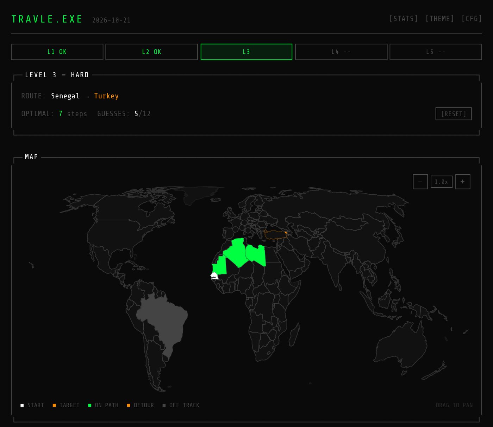
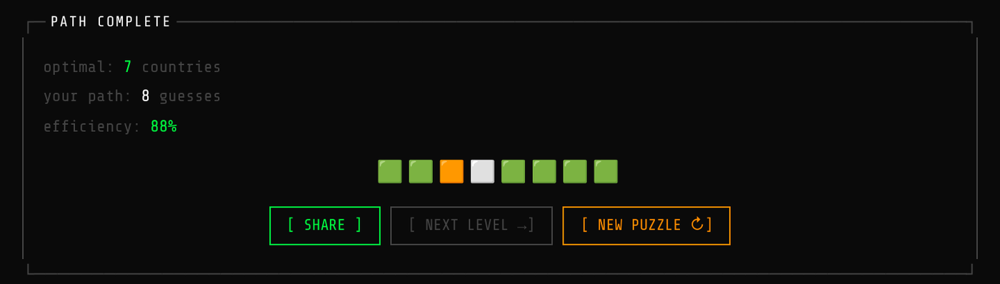
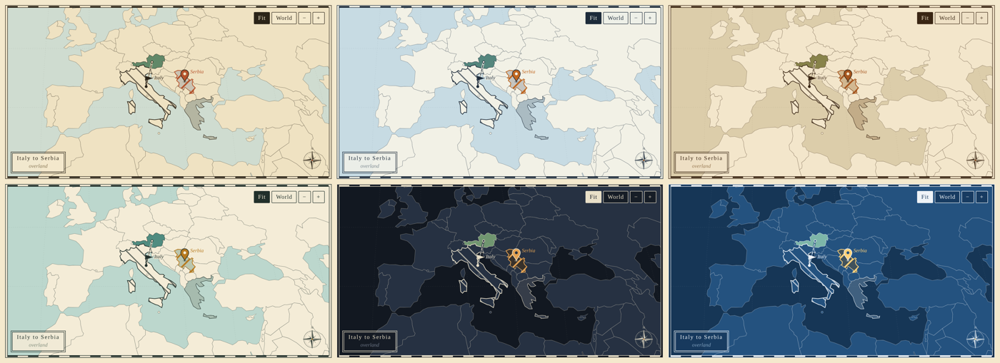

<div align="center">

# travle.exe

**a geography puzzle game that looks like a terminal**

get from one country to another by naming the countries in between

<a href="https://travle-game.vercel.app/"></a>


<br /><br />



</div>

<br />

## the idea

you get a start country and a target country. you type in countries one by one, and every one has to share a land border with the last one you got right. connect the two and you win.

above is a level 3 round from Senegal to Turkey. Mauritania, Algeria and Libya are on track, Armenia was a detour and Brazil was a cry for help.

## how a round works

every session gives you 5 levels and they get meaner as you go:

| level | name | route length |
| :-- | :-- | :-- |
| 1 | easy | 2 to 3 hops |
| 2 | medium | 4 to 5 hops |
| 3 | hard | 6 to 7 hops |
| 4 | expert | 8 to 10 hops |
| 5 | nightmare | 11 or more, through some very obscure countries |

you get guesses equal to the shortest route plus 5, and a wrong guess still eats one. beat a level to unlock the next.


every guess gets a colour so you know how you're doing, measured from everything you've already linked to the start:

| colour | meaning |
| :-- | :-- |
| 🟩 green | you moved one step closer to the target |
| 🟧 orange | a detour, you're a bit off the best route |
| ⬜ grey | way off, or doesn't connect at all |

you don't have to follow the shortest route either. if the countries you guessed link up into any valid chain from start to finish, it counts.

no double dipping: once you've entered a country you can't enter it again, and your start country is off limits too.

### ocean crossings

flip **OCEAN CROSSINGS** on in `[CFG]` and short sea hops start counting as borders: the English Channel, Gibraltar, the Red Sea, the Korea Strait, Pacific island chains, and the Bering Strait so you can go straight from the United States to Russia. that's also what lets island countries like Japan, Sri Lanka, Australia and Fiji show up in puzzles. long open-ocean jumps (no crossing the Atlantic) are left out on purpose. toggling it rebuilds all five levels with the new map, and sea hops show as `~>` in the optimal path.



when you finish you get your efficiency and a little emoji row you can share to flex on people.

stuck? **[HINT]** gives you the first letter of the next stop, hit it again for the full name. each hint burns one guess and shows up as 💡 in your share.

### the map

it zooms in to frame your route and follows along as you guess, so a round through the Balkans isn't a speck on a world map. the countries you've linked up get joined with lines (dashed for sea hops), hovering a country you've revealed shows its name, and tiny countries the world map can't draw (Malta, Singapore, the Pacific islands) show up as dots. drag to pan, ctrl+scroll or pinch to zoom, and **FIT** snaps back to your route.

## themes

20 of them. Dracula, Nord, Tokyo Night, Gruvbox, Catppuccin Mocha, Synthwave, Amber, Matrix and more, plus the plain green on black one it ships with.



<sub>dracula, synthwave, nord, amber, tokyo night, gruvbox</sub>

there's also CRT scanlines, sound effects and a green text mode, all toggleable in settings.

## under the hood

the world is an adjacency list. countries are nodes and shared land borders are edges, with an optional second layer of sea edges for ocean mode. every guess runs a breadth first search to the target and compares the distance before and after, and that's what decides the colour.

puzzles come from a seed fed into a tiny random number generator (mulberry32). the seed is fresh every browser session so you get new routes each time you open it, and each level only picks routes inside its hop range. level 5 pulls from the weird landlocked countries on purpose.

your stats sit in local storage: games played, wins, current streak, best streak and a 30 day history chart. nothing leaves your browser.

## run it yourself

```bash
git clone https://github.com/mominmansoor/Travle-game-
cd Travle-game-
npm install
npm run dev
```

then open http://localhost:3000

## where things live

```
app/          the page and layout
components/   map, guess input, guess history, stats chart, terminal frame, theme picker
data/         countries, border data, sea links, puzzle generation, themes
lib/          BFS pathfinding, game state, audio, theme handling
docs/         the screenshots in this readme
```

<div align="center">
<br />
<sub><code>&gt; built with react-simple-maps and world-atlas</code></sub>
</div>
