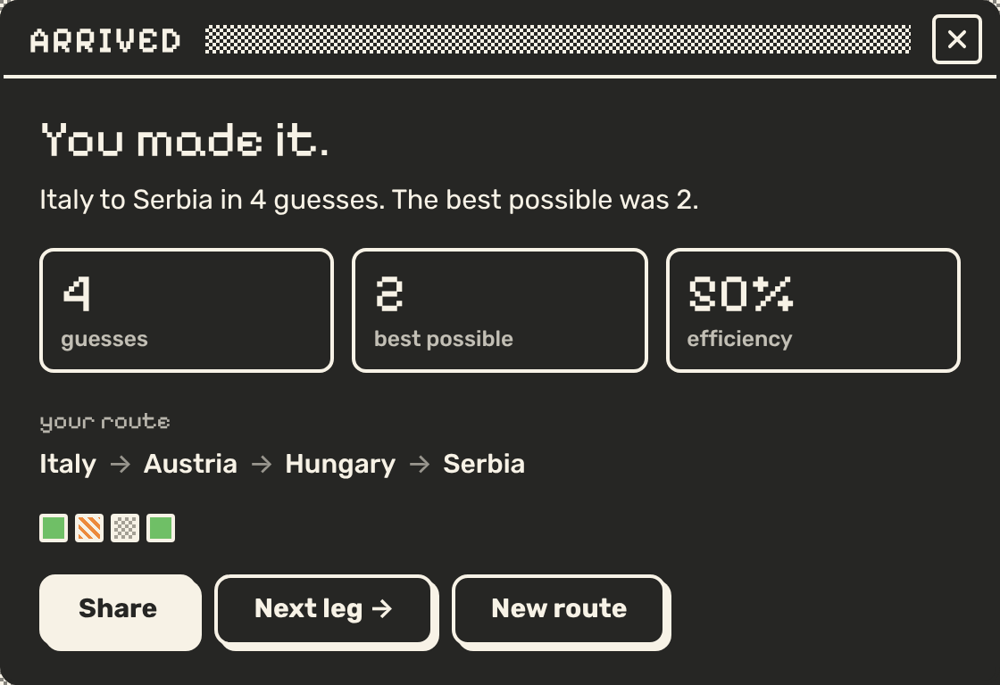
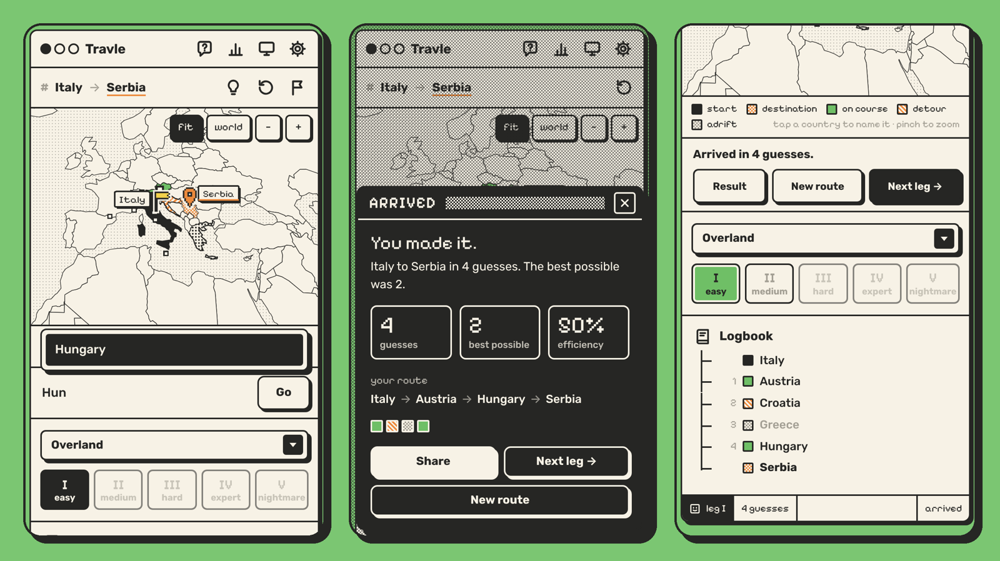

<div align="center">

# travle

**a geography puzzle game that lives in a little retro desktop**

get from one country to another by naming the countries in between

<a href="https://travle-game.vercel.app/"></a>


<br /><br />


</div>

<br />

## the idea

you get a start country and a destination. type in countries one at a time, and each one has to share a land border with something you've already linked to the start. connect the two and you've arrived.

above is an easy leg from Italy to Serbia. Austria is on course, Croatia was a detour and Greece was a wrong turn.

## how a round works

every visit gives you five legs, and they get meaner as you go:

| leg | in the sidebar | difficulty | route length |
| :-- | :-- | :-- | :-- |
| I | `# coastal` | easy | 2 to 3 hops |
| II | `# inland` | medium | 4 to 5 hops |
| III | `# frontier` | hard | 6 to 7 hops |
| IV | `# uncharted` | expert | 8 to 10 hops |
| V | `# here-be-dragons` | nightmare | 11 or more, through some very obscure countries |

there's no limit on guesses, so you can keep going until you get there, but the fewer you use the better your efficiency score. stuck? the 💡 bulb shows the first letter of the next stop, and tapping it again gives the full name. the ⚑ flag turns back, which ends the leg and shows you the route. finish or turn back to unlock the next leg, and unlocked legs stay unlocked next time you visit.

every guess gets a colour and a pattern, judged from everything you've already linked to the start:

| guess | on the map | meaning |
| :-- | :-- | :-- |
| 🟩 on course | solid green | you moved one step closer |
| 🟧 detour | orange stripes | a bit off the best route, up to two steps |
| ⬜ adrift | grey dot dither | way off, or doesn't connect at all |

you don't have to follow the shortest route either. if the countries you've named link up into any valid chain from start to finish, it counts.

no double dipping: once you've entered a country you can't enter it again, and your start country is off limits too.

when a leg ends, a result window shows your guesses against the best possible, your efficiency, the route you took and a row of squares you can share.



### land & sea

switch the dropdown at the top of the sidebar from **Overland** to **Land & sea** (it's also in settings) and seas and oceans become stops you can name, just like countries. countries never connect straight across water: to cross, you have to type the water itself. United States → **Bering Strait** → Russia, United Kingdom → **English Channel** → France, Spain → **Mediterranean Sea** → Egypt. each one counts as a guess.

there are 32 of them, from the five oceans down to straits like Gibraltar, and common names work too ("Med", "Bering Sea", "Arabian Gulf"). this is also what puts island countries like Japan, Sri Lanka, Australia and Fiji into puzzles. since an ocean touches dozens of coasts the world gets a lot smaller, so this mode uses shorter routes for each leg. switching rebuilds all five legs.

### the map

it zooms in to frame your route and follows along as you guess, so a round through the Balkans isn't a speck on a world map. the countries you've linked up get joined with route lines (dashed across water), your start gets a pixel flag and the destination a pixel pin, and tiny countries the world map can't draw (Malta, Singapore, the Pacific islands) show up as little squares. hover or tap a country you've revealed to see its name. drag to pan, ctrl+scroll or pinch to zoom, and **fit** snaps back to your route.

### keyboard

press <kbd>/</kbd> from anywhere to start typing, <kbd>↑</kbd> <kbd>↓</kbd> to pick a suggestion, <kbd>Tab</kbd> to fill it in, <kbd>Enter</kbd> to guess and <kbd>Esc</kbd> to clear the box or close a window.

## the look

the whole game is one window sitting on a flat desktop, a bit like an old Mac or a 1-bit handheld: thick ink outlines, hard drop shadows, dithered patterns and pixel lettering. the sidebar is a file tree with the five legs and the logbook of your guesses underneath. the map and guess bar sit on the right, and a status bar runs along the bottom. help, the ledger (your stats), display and settings each open as their own popup window.

because every kind of guess has its own pattern as well as its own colour, the map still reads in the near-monochrome palettes. there are five palettes in the display menu:


<sub>desktop, inbox, midnight / beige box, blueprint</sub>

### on a phone

it's built to be played on a phone too. the menu buttons move into the title bar, the map gets taller and the guess bar sits right under it, so you can see the map while you type. the legs turn into a row of tiles (green once you've arrived), the logbook moves below, and popups slide up from the bottom with full-width buttons.



## under the hood

the world is an adjacency list. countries are nodes and shared land borders are edges, with an optional second layer of sea edges for land & sea mode. every guess runs a breadth first search to the destination and compares the distance before and after, and that's what decides the colour.

puzzles come from a seed fed into a tiny random number generator (mulberry32). the seed is fresh every browser session so you get new routes each time you open it, and each leg only picks routes inside its hop range. leg V pulls from the weird landlocked countries on purpose.

the map is SVG via react-simple-maps. the dither patterns are scaled against the zoom, so one "pixel" of dither is always two screen pixels however far in you are. on narrow screens the map frame gets taller, and the camera framing takes the frame's height into account. the fonts (Rubik and Pixelify Sans) are bundled with the site rather than loaded from Google.

your stats, palette, settings and unlocked legs sit in local storage: games played, arrivals, current streak, best streak and a 30 day chart. nothing leaves your browser.

## run it yourself

```bash
git clone https://github.com/mominmansoor/Travle-game-
cd Travle-game-
npm install
npm run dev
```

then open http://localhost:3000

## where things live

```
app/          the page, layout and all the styles
components/   map, guess bar, logbook, ledger chart, popup window, icons, palette picker
data/         countries, border data, sea links, map geometry, puzzle generation, palettes
lib/          BFS pathfinding, game state, audio, palette handling
docs/         the screenshots in this readme
```

<div align="center">
<br />
<sub>built with react-simple-maps and world-atlas</sub>
</div>
